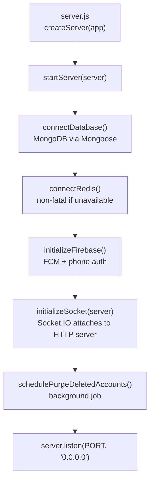
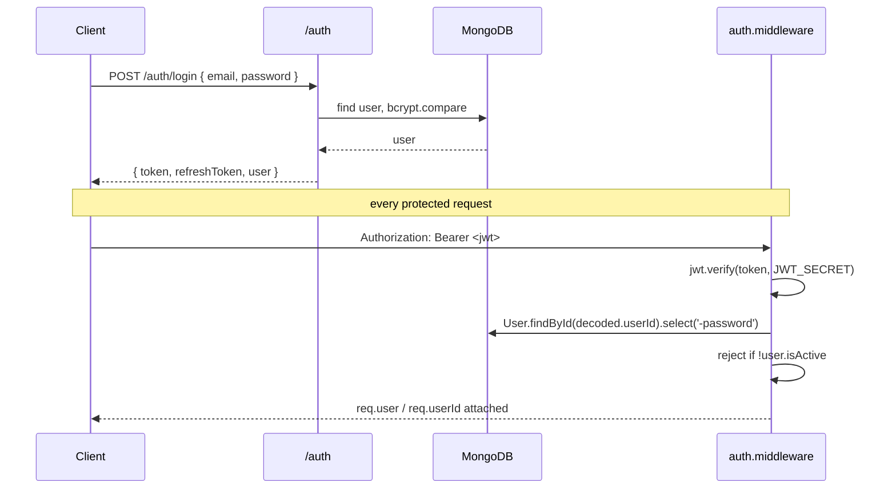
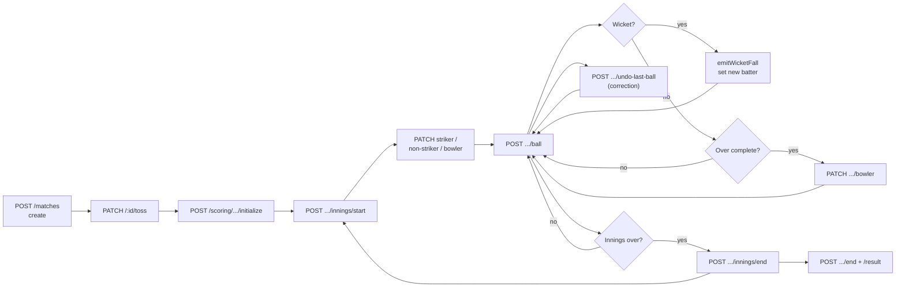

<div align="center">

# 🏏 Scores11 / Crick11 — Backend API

### _Cricket platform API — live ball-by-ball scoring, fantasy contests, streaming, wallet & social._

<br/>

[](https://nodejs.org)
[](https://expressjs.com)
[](https://mongoosejs.com)
[](https://socket.io)

[](https://jwt.io)
[](https://redis.io)
[](https://cloudinary.com)
[](https://firebase.google.com)
[](https://swagger.io)
[](https://docs.docker.com/compose/)

<br/>

**38 Modules** ・ **507 Routes** ・ **35 Data Models** ・ **213 Files** ・ **~32,000 LOC**

<br/>

[Quick Start](#-quick-start) ・ [Architecture](#-architecture) ・ [Modules](#-module-reference) ・ [API](#-api-reference) ・ [Scoring Engine](#-live-scoring-engine) ・ [Known Issues](#️-known-issues)

</div>

---

## 📖 Table of Contents

| # | Section | What's inside |
| :--: | --- | --- |
| 1 | [✨ Overview](#-overview) | What the API does, feature map |
| 2 | [🧰 Tech Stack](#-tech-stack) | Every dependency and its job |
| 3 | [🚀 Quick Start](#-quick-start) | Running locally in 4 commands |
| 4 | [🔐 Environment Variables](#-environment-variables) | Every `.env` key, grouped |
| 5 | [🗂️ Project Structure](#️-project-structure) | Folder tree + module anatomy |
| 6 | [🧭 Architecture](#-architecture) | Request lifecycle, layering rules |
| 7 | [📦 Module Reference](#-module-reference) | All 38 modules at a glance |
| 8 | [🔑 Auth & Roles](#-auth--roles) | JWT flow, 8 roles, permissions |
| 9 | [📡 Response & Error Format](#-response--error-format) | The envelope every route returns |
| 10 | [🧱 Middleware Reference](#-middleware-reference) | What each middleware does |
| 11 | [🌐 API Reference](#-api-reference) | All 507 endpoints, grouped |
| 12 | [🔴 Real-Time (Socket.IO)](#-real-time-socketio) | Rooms, events, emit helpers |
| 13 | [🏏 Live Scoring Engine](#-live-scoring-engine) | Ball types, rules, match flow |
| 14 | [🗄️ Data Models](#️-data-models) | All 35 Mongoose models |
| 15 | [🌱 Seeding & Scripts](#-seeding--scripts) | Bootstrap data, admin user |
| 16 | [🚢 Deployment](#-deployment) | PM2, Docker, GitHub Actions |
| 17 | [⚠️ Known Issues](#️-known-issues) | Verified bugs worth fixing |
| 18 | [🐛 Troubleshooting](#-troubleshooting) | Common failures and fixes |
| 19 | [🤝 Contributing](#-contributing) | How to add a module |

---

## ✨ Overview

This is the **Express + MongoDB** API behind the Scores11 cricket platform. It serves three clients from one codebase:

| Client | Repo / folder | Notes |
| --- | --- | --- |
| 🌐 **User website** | `Score-11-User` (React + Vite) | Live at `https://scores11.com` |
| 🖥️ **Web frontend** | `frontend` | Sibling React app |
| 📱 **Flutter app** | `cric11_app` | Has dedicated compatibility endpoints (e.g. `full-scorecard`) |

The API is **modular by domain** — every feature is a self-contained folder under `src/modules/` with its own routes, controller, service, model and validation. Adding a feature means adding a folder and one line in `src/routes.js`.

### 🎯 Feature Map

| Domain | Capability |
| --- | --- |
| 🔐 **Auth** | Email/password register & login, JWT + refresh tokens, Firebase phone auth, email OTP, password reset |
| 👤 **Users** | Profiles, avatar & cover upload, follow/unfollow, cricket stats, achievements, QR code, equipment, account deletion with purge job |
| 🏏 **Matches** | Full lifecycle — create, schedule, toss, officials, status transitions, timeline, scorecard |
| ⚡ **Scoring** | Ball-by-ball engine: legal deliveries, extras, wickets, overs, innings, **undo**, **retire batter**, **rain/DLS**, strike swap |
| 👥 **Teams** | Squads, captain & vice-captain, invites by code, logo upload, transfers, verification |
| 🧑 **Players** | Player records, instant creation, search, compare, stats, per-match performance, opt-out |
| 🪪 **Player Profiles** | Verified profile applications, stat uploads, linking to player records |
| 🏆 **Tournaments** | Registration, league & knockout fixture generation, points table, stats |
| 🎮 **Contests** | Fantasy contests, invite codes, team entries, points, ranks, prize distribution |
| 💰 **Wallet** | Balance, deposit, withdraw, transfer, contest entry & prize ledger, statements |
| 📺 **Live Streams** | ZenStream RTMP, YouTube Live OAuth, Agora tokens, chat, likes, viewer join/leave |
| 🥇 **Leaderboard** | Global, batsmen, bowlers, all-rounders, teams, per-tournament, per-match |
| 📰 **Content** | Blogs, news, community posts, stories, reviews |
| 🛍️ **Commerce** | Store products & orders, subscriptions |
| 🏛️ **Org** | Clubs, associations, awards |
| 🔔 **Platform** | Notifications (FCM), search, settings, banners, feature toggles, chat, discovery, contact |
| 🛡️ **Admin** | 70 admin routes — analytics, moderation, backups, email templates, API keys, webhooks, app config |

---

## 🧰 Tech Stack

### Core

| Package | Version | Role |
| --- | :--: | --- |
| `express` | `4.22.1` | HTTP framework, routing, middleware pipeline |
| `mongoose` | `8.23.0` | MongoDB ODM — schemas, validation, population |
| `socket.io` | `4.8.3` | Real-time match rooms and live score push |
| `jsonwebtoken` | `9.0.3` | Access and refresh token signing/verification |
| `bcryptjs` | `2.4.3` | Password hashing |
| `joi` | `18.1.2` | Schema validation (primary) |
| `express-validator` | `7.3.1` | Request validation (secondary, some modules) |
| `dotenv` | `16.6.1` | Loads `.env` into `process.env` |

### Integrations

| Package | Version | Role |
| --- | :--: | --- |
| `cloudinary` | `1.41.3` | Remote media storage for avatars, logos, covers |
| `firebase-admin` | `12.0.0` | FCM push notifications + phone ID-token verification |
| `agora-access-token` | `2.0.4` | Generates RTC tokens for live video |
| `nodemailer` | `6.9.13` | SMTP mail — verification, password reset |
| `redis` | `4.7.1` | Caching / sessions (optional — API degrades gracefully) |
| `axios` | `1.15.2` | Outbound HTTP to ZenStream and YouTube APIs |

### Infrastructure

| Package | Version | Role |
| --- | :--: | --- |
| `multer` | `1.4.5-lts.1` | Multipart upload handling (10 MB cap) |
| `winston` | `3.19.0` | Structured logging to files and console |
| `morgan` | `1.10.1` | HTTP access logs, piped into Winston |
| `express-rate-limit` | `7.0.0` | Global + auth-specific throttling |
| `cors` | `2.8.6` | Cross-origin config |
| `swagger-ui-express` | `5.0.0` | Interactive docs at `/api-docs` |
| `csv-writer` | `1.6.0` | Analytics and financial exports |
| `yaml` | `2.4.1` | YAML parsing |
| `nodemon` | `3.1.14` | Dev auto-restart |

---

## 🚀 Quick Start

### Prerequisites

| Requirement | Minimum | Notes |
| --- | :--: | --- |
| **Node.js** | `20+` | The Dockerfile pins `node:20-alpine` |
| **MongoDB** | `6+` | Local or Atlas |
| **Redis** | `7` | Optional — the API starts fine without it |
| **npm** | `9+` | Ships with Node 20 |

### Installation

```bash
# 1  Enter the backend
cd backend

# 2  Install dependencies
npm install

# 3  Create your env file and fill in the secrets
cp .env.example .env

# 4  Start in watch mode
npm run dev
```

API boots at **http://localhost:3000**

### Verify It's Alive

```bash
curl http://localhost:3000/          # service banner
curl http://localhost:3000/health    # mongo + redis status
curl http://localhost:3000/api/v1    # API version banner
```

`/health` returns `200` when Mongo is connected and `503` when it is not:

```json
{
  "status": "ok",
  "services": { "mongodb": "connected", "redis": "connected" },
  "uptime": 128.4,
  "environment": "development"
}
```

### Scripts

| Command | What it does |
| --- | --- |
| `npm run dev` | Nodemon watch mode |
| `npm start` | Production start (`node src/server.js`) |
| `npm run seed` | Seed the admin user |
| `npm run seed:admin` | Same as above, explicit |
| `npm run seed:user` | Seed a regular test user |
| `npm run db:reset-test` | Reset the test database |

---

## 🔐 Environment Variables

Copy `.env.example` → `.env`. Defaults come from [`src/config/env.js`](src/config/env.js).

### Core

| Variable | Default | Description |
| --- | --- | --- |
| `NODE_ENV` | `development` | Switches Mongo URI and disables morgan under `test` |
| `PORT` | `3000` | Listen port, bound to `0.0.0.0` |

### Auth

| Variable | Default | Description |
| --- | --- | --- |
| `JWT_SECRET` | `default-secret-key` | ⚠️ **Must be overridden** — min 32 chars |
| `JWT_EXPIRE` | `30d` | Access token lifetime |
| `JWT_REFRESH_SECRET` | `default-refresh-secret` | ⚠️ **Must be overridden** |
| `JWT_REFRESH_EXPIRE` | `90d` | Refresh token lifetime |

### Database

| Variable | Default | Description |
| --- | --- | --- |
| `MONGODB_URI` | `mongodb://localhost:27017/crick11` | Used when `NODE_ENV !== production` |
| `MONGODB_URI_PROD` | — | Used when `NODE_ENV === production` |
| `MONGODB_DB_NAME` | `crick11` | Database name passed to Mongoose |
| `REDIS_HOST` | `localhost` | Redis host |
| `REDIS_PORT` | `6379` | Redis port |
| `REDIS_PASSWORD` | _(empty)_ | Leave blank if unprotected |

### Media & Messaging

| Variable | Description |
| --- | --- |
| `CLOUDINARY_CLOUD_NAME` / `CLOUDINARY_API_KEY` / `CLOUDINARY_API_SECRET` | Cloudinary credentials for uploads |
| `FIREBASE_PROJECT_ID` | Primary Firebase project |
| `FIREBASE_AUTH_PROJECT_ID` / `FIREBASE_AUTH_PROJECT_IDS` | Extra project IDs accepted when verifying phone ID tokens (comma-separated) |
| `FIREBASE_PRIVATE_KEY` | Service-account key — keep the `\n` escapes, they are unescaped at load |
| `FIREBASE_CLIENT_EMAIL` / `FIREBASE_DATABASE_URL` | Service-account details |
| `SMTP_HOST` / `SMTP_PORT` / `SMTP_USER` / `SMTP_PASS` | Outbound mail (defaults to Gmail SMTP) |
| `EMAIL_FROM` | From header, e.g. `"Crick11" <noreply@crick11.app>` |

### Limits & Business Rules

| Variable | Default | Description |
| --- | --- | --- |
| `CORS_ORIGIN` | `http://localhost:5173` | Also used as the Socket.IO CORS origin |
| `RATE_LIMIT_WINDOW_MS` | `900000` | 15-minute window |
| `RATE_LIMIT_MAX_REQUESTS` | `100` | Requests per window per IP |
| `TOURNAMENT_AUTO_CLOSE_DAYS` | `7` | Auto-close tournaments after N days |
| `MATCH_REMINDER_HOURS` | `24` | Reminder lead time |
| `WALLET_MIN_DEPOSIT` | `10` | Minimum deposit |
| `WALLET_MAX_DEPOSIT` | `10000` | Maximum deposit |
| `WALLET_MIN_WITHDRAWAL` | `100` | Minimum withdrawal |

### Streaming

| Variable | Default | Description |
| --- | --- | --- |
| `ZENSTREAM_API_KEY` / `ZENSTREAM_API_SECRET` | — | Either one fills in for the other |
| `ZENSTREAM_BASE_URL` | `https://api.zenstream.live/v1` | ZenStream API root |
| `ZENSTREAM_RTMP_SERVER` | `rtmp://live-ingest-01.vd0.co:1935/livestream` | RTMP ingest |
| `ZENSTREAM_PLAYER_URL` | `https://player.zenstream.live` | Player domain |
| `ZENSTREAM_HLS_URL` | _(empty)_ | Optional HLS base |
| `YOUTUBE_API_KEY` | — | YouTube Data API key |
| `GOOGLE_CLIENT_ID` / `YOUTUBE_CLIENT_ID` | — | OAuth client (either name works) |
| `GOOGLE_CLIENT_SECRET` / `YOUTUBE_CLIENT_SECRET` | — | OAuth secret |
| `GOOGLE_REDIRECT_URI` / `YOUTUBE_REDIRECT_URI` | `http://localhost:3000/api/v1/live-streams/youtube/callback` | OAuth callback |
| `YOUTUBE_API_SCOPE` | `https://www.googleapis.com/auth/youtube` | Comma-separated scopes |

### Seed Credentials

| Variable | Default | Description |
| --- | --- | --- |
| `ADMIN_SEED_EMAIL` | `admin@crick11.com` | Admin bootstrap email |
| `ADMIN_SEED_PASSWORD` | `admin123` | ⚠️ Change before any real deployment |
| `ADMIN_SEED_USERNAME` / `ADMIN_SEED_NAME` / `ADMIN_SEED_PHONE` | — | Admin profile fields |
| `SEED_USER_EMAIL` / `SEED_USER_PASSWORD` / `SEED_USER_PHONE` | — | Test user credentials |

> [!WARNING]
> `JWT_SECRET` and `JWT_REFRESH_SECRET` have **working fallback defaults** in `env.js`. If you forget to set them the API still boots — with a publicly known signing key. Always set both in production.

---

## 🗂️ Project Structure

```txt
backend/
│
├── src/
│   ├── server.js                  Creates the HTTP server, calls startServer()
│   ├── app.js                     Express app, middleware, /health, boot sequence
│   ├── routes.js                  Mounts all 36 route groups under /api/v1
│   │
│   ├── config/
│   │   ├── env.js                 Central typed config from process.env
│   │   ├── database.js            Mongo connection + reconnect handlers
│   │   ├── redis.js               Redis client (non-fatal on failure)
│   │   ├── socket.js              Socket.IO server, rooms, emit helpers
│   │   ├── cloudinary.js          Cloudinary SDK setup
│   │   ├── firebase.js            Firebase Admin init
│   │   ├── logger.js              Winston logger + morgan stream
│   │   └── swagger.js             Hand-maintained OpenAPI route catalogue
│   │
│   ├── middleware/
│   │   ├── auth.middleware.js     Verifies JWT, loads req.user
│   │   ├── role.middleware.js     authorize(...roles) guard
│   │   ├── rateLimiter.middleware.js  Global + authLimiter
│   │   ├── upload.middleware.js   Multer disk storage, 10 MB, type filter
│   │   ├── validate.middleware.js Joi body validation
│   │   ├── validateParams.middleware.js / validateQuery.middleware.js
│   │   ├── error.middleware.js    Central error -> friendly JSON
│   │   └── notFound.middleware.js 404 handler
│   │
│   ├── modules/                   38 domain modules (see Module Reference)
│   │   └── <domain>/
│   │       ├── <domain>.routes.js       Route table + guards
│   │       ├── <domain>.controller.js   HTTP in/out only
│   │       ├── <domain>.service.js      Business logic
│   │       ├── <domain>.model.js        Mongoose schema
│   │       └── <domain>.validation.js   Joi schemas
│   │
│   ├── constants/
│   │   ├── roles.js               ROLES + ROLE_PERMISSIONS
│   │   ├── matchStatus.js         Match lifecycle states
│   │   ├── tossDecision.js        bat | bowl
│   │   ├── tournamentStatus.js    Tournament lifecycle
│   │   ├── userLevels.js          USER_LEVELS + USER_TITLES
│   │   ├── errorMessages.js       Shared copy
│   │   └── index.js               Barrel (see Known Issues)
│   │
│   ├── utils/
│   │   ├── ApiResponse.js         Success envelope helper
│   │   ├── ApiError.js            Typed error class + factories
│   │   ├── catchAsync.js          Async wrapper so throws reach the handler
│   │   ├── friendlyError.js       Mongo/Joi errors -> human messages
│   │   ├── cricketScoringRules.js Ball profiles + run-scoring taxonomy
│   │   ├── statCalculator.js      Averages, strike rate, economy
│   │   ├── generateToken.js       JWT signing
│   │   ├── passwordHasher.js      bcrypt wrapper
│   │   ├── pagination.js          Shared paging
│   │   ├── emailSender.js / sendVerificationEmail.js
│   │   └── fileUploader.js        Cloudinary upload helper
│   │
│   ├── jobs/
│   │   └── purgeDeletedAccounts.js  Scheduled hard-delete of soft-deleted users
│   │
│   ├── seeds/                     Admin, roles, teams, players, live-match seeders
│   ├── scripts/resetTestDatabase.js
│   └── routes/scoring.routes.js   ⚠️ dead duplicate (see Known Issues)
│
├── uploads/                       Multer disk destination
├── logs/                          Winston output
├── dockerfile                     node:20-alpine production image
├── docker-compose.yml             app + mongo:7 + redis:7-alpine
├── .github/workflows/deploy.yml   Auto-deploy to VPS on push to main
└── .env.example
```

### Module Anatomy

Every module follows the same five-file shape. `match` is the reference implementation:

```txt
modules/match/
├── match.routes.js        3.7 KB   paths + guards, no logic
├── match.controller.js    9.1 KB   reads req, calls service, returns ApiResponse
├── match.service.js      39.1 KB   all business logic, DB access
├── match.model.js         7.1 KB   Mongoose schema + indexes
└── match.validation.js    2.7 KB   Joi schemas for the routes
```

> [!TIP]
> **Controllers must stay thin.** If you are writing a `Model.find()` inside a controller, it belongs in the service. The scoring module is the clearest example of this split — an 86 KB service behind a 9 KB controller.

---
## 🧭 Architecture

### Boot Sequence

`server.js` creates the HTTP server, then `app.js` → `startServer()` runs this order. A failure in any step exits the process with code 1:



> [!NOTE]
> Socket.IO attaches to the **same HTTP server** as Express, so REST and WebSocket share one port (`3000`). A reverse proxy must forward both `/api/` and `/socket.io/` to it.

### Request Lifecycle

```txt
Request
   ↓
cors()                        permissive — reflects any origin
   ↓
express.json()                10 MB body limit
   ↓
morgan -> winston             skipped when NODE_ENV=test
   ↓
rateLimiter                   100 req / 15 min per IP
   ↓
/api/v1 router                routes.js -> module router
   ↓
auth middleware               verifies JWT, loads req.user      [if route guarded]
   ↓
authorize(...roles)           role check                        [if route guarded]
   ↓
validate(schema)              Joi validation                    [if route validated]
   ↓
controller                    reads req, calls service
   ↓
service                       business logic + Mongoose
   ↓
ApiResponse.success(...)      consistent envelope
   ↓
notFoundMiddleware            unmatched routes -> 404
   ↓
errorMiddleware               any throw -> friendly JSON
```

### Layering Rules

| Layer | May do | Must not do |
| --- | --- | --- |
| **Routes** | Declare paths, attach guards and validation | Contain logic |
| **Controller** | Read `req`, call one service, shape the response | Query the database |
| **Service** | Business rules, Mongoose queries, emit socket events | Touch `req` / `res` |
| **Model** | Schema, indexes, virtuals, hooks | Business rules |
| **Validation** | Joi schemas | Database lookups |

---

## 📦 Module Reference

All 38 modules, mounted in [`src/routes.js`](src/routes.js) under `/api/v1`.

### Core Cricket

| Module | Mount | Routes | Purpose |
| --- | --- | :--: | --- |
| `match` | `/matches` | 27 | Match lifecycle, toss, officials, timeline, scorecard |
| `scoring` | `/scoring` | 19 | **Ball-by-ball engine** — the heart of the platform |
| `team` | `/teams` | 24 | Squads, captains, invites, logos, transfers |
| `player` | `/players` | 24 | Player records, search, compare, stats |
| `playerProfile` | `/player-profiles` | 12 | Verified profile applications and linking |
| `tournament` | `/tournaments` | 18 | Registration, fixtures, points table |
| `leaderboard` | `/leaderboard` | 13 | Rankings across every dimension |
| `performance` | `/performance` | 7 | Per-match performance records |

### Engagement & Money

| Module | Mount | Routes | Purpose |
| --- | --- | :--: | --- |
| `contest` | `/contests` | 15 | Fantasy contests, entries, prizes |
| `wallet` | `/wallet` | 12 | Balance, deposits, withdrawals, ledger |
| `subscription` | `/subscriptions` | 6 | Premium plans |
| `store` | `/store` | 19 | Products and orders |
| `discovery` | `/discovery` | 12 | Nearby / popular / featured listings |

### Content & Social

| Module | Mount | Routes | Purpose |
| --- | --- | :--: | --- |
| `blog` | `/blogs` | 17 | Articles, categories, comments, likes |
| `news` | `/news` | 12 | News with breaking/region support |
| `community` | `/community` | 15 | Social posts, comments, reports, pins |
| `story` | `/stories` | 4 | Short-lived stories |
| `review` | `/reviews` | 8 | Ratings with approval workflow |
| `chat` | `/chat` | 3 | Direct messages |
| `liveStream` | `/live-streams` | 17 | ZenStream, YouTube Live, Agora, chat |

### Organisation

| Module | Mount | Routes | Purpose |
| --- | --- | :--: | --- |
| `club` | `/clubs` | 9 | Clubs, members, affiliated teams |
| `association` | `/associations` | 7 | Governing bodies |
| `award` | `/awards` | 7 | Awards and winners |

### Identity & Platform

| Module | Mount | Routes | Purpose |
| --- | --- | :--: | --- |
| `auth` | `/auth` | 13 | Login, register, Firebase phone, OTP, reset |
| `user` | `/user` | 49 | Profiles, follows, stats, admin user management |
| `role` | `/roles` | 5 | Dynamic role records |
| `dashboard` | `/dashboard` | 12 | Aggregated home-screen payloads |
| `notification` | `/notifications` | 13 | In-app + FCM push |
| `settings` | `/settings` | 7 | User preferences, privacy, 2FA |
| `upload` | `/upload` | 6 | Image/video upload, Cloudinary signature |
| `search` | `/search` | 1 | Cross-entity search |
| `banner` | `/banners` | 11 | Promo banners with click analytics |
| `featureToggle` | `/feature-toggles` | 6 | Runtime feature flags |
| `contact` | `/contact` | 7 | Support tickets |
| `report` | _(model only)_ | — | Backing model for user reports |
| `admin` | `/admin` | 70 | Full admin surface |

---

## 🔑 Auth & Roles

### Token Flow



### What `auth` Attaches

[`middleware/auth.middleware.js`](src/middleware/auth.middleware.js) sets three things for backwards compatibility:

| Property | Value |
| --- | --- |
| `req.user` | Full Mongoose user document, password stripped |
| `req.userId` | `user._id` |
| `req.user.userId` | `user._id` (legacy alias) |

Exported as `auth`, `authenticate` (alias) and default — all the same function.

### Auth Errors

| Condition | Status | Message |
| --- | :--: | --- |
| No / malformed `Authorization` header | `401` | `No token provided` |
| Bad signature | `401` | `Invalid token` |
| Expired | `401` | `Token expired` |
| User deleted | `401` | `User not found` |
| `isActive === false` | `401` | `User account is deactivated` |

### Roles

Defined in [`src/constants/roles.js`](src/constants/roles.js):

| Role | Value | Typical use |
| --- | --- | --- |
| 👤 User | `user` | Default signup role |
| 🏏 Player | `player` | Appears in squads |
| 🧢 Captain | `captain` | Team leadership |
| 📋 Manager | `manager` | Team management |
| ✍️ Scorer | `scorer` | Runs live scoring |
| 🧑‍⚖️ Umpire | `umpire` | Match officiating |
| 🛡️ Moderator | `moderator` | Content moderation |
| 👑 Admin | `admin` | Full access |

### Permissions

`ROLE_PERMISSIONS` maps four of these roles to permission strings:

| Role | Permissions |
| --- | --- |
| `admin` | `manage_users` `manage_players` `manage_teams` `manage_tournaments` `manage_matches` `view_analytics` `manage_wallet` `manage_notifications` `super_admin` |
| `player` | `view_own_profile` `update_own_profile` `view_matches` `participate_in_matches` `view_teams` `update_player_stats` |
| `umpire` | `view_matches` `manage_match_scoring` `update_match_status` `view_teams` |
| `user` | `view_own_profile` `update_own_profile` `view_matches` `view_tournaments` `create_team` `join_tournament` |

> [!NOTE]
> `ROLE_PERMISSIONS` is a **reference map only** — `authorize()` checks the role name, not these permission strings. `captain`, `manager`, `moderator` and `scorer` have no entry here.

### Using the Guard

```js
import { authenticate } from '../../middleware/auth.middleware.js';
import { authorize } from '../../middleware/role.middleware.js';
import { ROLES } from '../../constants/roles.js';

// any signed-in user
router.get('/my-matches', authenticate, controller.getMyMatches);

// specific roles only
router.delete('/:id', authenticate, authorize(ROLES.ADMIN), controller.deleteMatch);

// authorize() with no arguments allows any authenticated user
router.post('/thing', authenticate, authorize(), controller.create);
```

---

## 📡 Response & Error Format

### Success

Built by [`utils/ApiResponse.js`](src/utils/ApiResponse.js):

```json
{
  "statusCode": 200,
  "message": "Live matches retrieved",
  "data": [ ... ],
  "success": true
}
```

| Helper | Status |
| --- | :--: |
| `ApiResponse.success(res, message, data)` | `200` (override with 4th arg) |
| `ApiResponse.created(res, message, data)` | `201` |
| `ApiResponse.error(res, message, statusCode)` | `500` default |

### Error

Produced by [`middleware/error.middleware.js`](src/middleware/error.middleware.js), which routes everything through `friendlyError.js` so raw Mongo errors never reach the client:

```json
{
  "success": false,
  "statusCode": 400,
  "message": "That email is already registered.",
  "errors": [ { "field": "email", "message": "..." } ]
}
```

`errors` is included only when validation details exist. Special cases handled: Mongoose `CastError`, duplicate key `11000`, and `ValidationError`.

### Throwing Errors

```js
import ApiError from '../../utils/ApiError.js';

throw ApiError.notFound('Match not found');
throw ApiError.badRequest('Overs must be greater than zero');
throw new ApiError(409, 'Team name already taken');
```

| Factory | Status |
| --- | :--: |
| `ApiError.badRequest()` | `400` |
| `ApiError.unauthorized()` | `401` |
| `ApiError.forbidden()` | `403` |
| `ApiError.notFound()` | `404` |
| `ApiError.conflict()` | `409` |
| `ApiError.tooManyRequests()` | `429` |
| `ApiError.internal()` | `500` |
| `ApiError.serviceUnavailable()` | `503` |

Wrap async controllers so rejections reach the handler:

```js
import { catchAsync } from '../../utils/catchAsync.js';

export const getMatch = catchAsync(async (req, res) => {
  const match = await matchService.getById(req.params.id);
  return ApiResponse.success(res, 'Match retrieved', match);
});
```

---

## 🧱 Middleware Reference

| Middleware | File | Behaviour |
| --- | --- | --- |
| **CORS** | `app.js` | Reflects **any** origin with `credentials: true` — see [Known Issues](#️-known-issues) |
| **Body parser** | `app.js` | JSON + urlencoded, `10mb` limit |
| **Rate limit (global)** | `rateLimiter.middleware.js` | 100 requests / 15 min per IP; skips Firebase phone-auth routes |
| **Rate limit (auth)** | `rateLimiter.middleware.js` | `authLimiter` — 10 attempts / 15 min |
| **auth** | `auth.middleware.js` | Bearer JWT → `req.user` |
| **authorize** | `role.middleware.js` | Role allow-list; empty args = any authenticated user |
| **validate** | `validate.middleware.js` | Joi body validation |
| **validateParams / validateQuery** | respective files | Joi for `req.params` / `req.query` |
| **upload** | `upload.middleware.js` | Multer disk storage → `uploads/`, 10 MB, allows `jpeg jpg png gif webp pdf doc docx` |
| **notFound** | `notFound.middleware.js` | Unmatched route → 404 envelope |
| **error** | `error.middleware.js` | Final error formatter |

Guard legend used in the API tables below:

| Icon | Meaning |
| :--: | --- |
| 🔒 | Requires a valid JWT |
| 👑 | Requires a specific role via `authorize()` |
| 📎 | Accepts a file upload |
| ✓ | Joi-validated body/params |
| _public_ | No authentication |

---

## 🌐 API Reference

**Base URL:** `/api/v1` ・ **Interactive docs:** `GET /api-docs`

### Service Endpoints

| Method | Endpoint | Auth | Purpose |
| :--: | --- | :--: | --- |
| `GET` | `/` | public | Service banner + environment |
| `GET` | `/health` | public | Mongo + Redis status, uptime |
| `GET` | `/api/v1` | public | API name, version, docs link |
| `GET` | `/api-docs` | public | Swagger UI |

---

<details open>
<summary><b>🔐 Auth — <code>/api/v1/auth</code> (13 routes)</b></summary>

<br/>

| Method | Endpoint | Auth | Purpose |
| :--: | --- | :--: | --- |
| `POST` | `/auth/register` | public | Create an account |
| `POST` | `/auth/login` | public | Email + password → JWT |
| `POST` | `/auth/phone/firebase` | public | Exchange a Firebase phone ID token for an app JWT |
| `POST` | `/auth/firebase/phone` | public | Alias of the above |
| `POST` | `/auth/phone-login` | public | Alias of the above |
| `POST` | `/auth/email/send-otp` | public | Send an email OTP |
| `POST` | `/auth/email/verify-otp` | public | Verify the email OTP |
| `POST` | `/auth/forgot-password` | public | Start password reset |
| `POST` | `/auth/reset-password` | public | Complete password reset |
| `POST` | `/auth/refresh-token` | public | Exchange a refresh token |
| `POST` | `/auth/logout` | 🔒 | Invalidate the session |
| `GET` | `/auth/me` | 🔒 | Current user |
| `POST` | `/auth/change-password` | 🔒 | Change password while signed in |

> The three Firebase phone routes are **exempt from the global rate limiter** (`isFirebasePhoneAuthRoute` in `rateLimiter.middleware.js`).

</details>

<details>
<summary><b>👤 User — <code>/api/v1/user</code> (49 routes)</b></summary>

<br/>

**Public**

| Method | Endpoint | Purpose |
| :--: | --- | --- |
| `POST` | `/user/register` | Register (✓ Joi validated) |
| `GET` | `/user/verify-email/:token` | Verify email via link |
| `POST` | `/user/verify-email` | Verify email via body |
| `GET` | `/user/profile/:username` | Public profile |
| `GET` | `/user/users/:id/avatar` | Public avatar |
| `GET` | `/user/list` | Public user list |
| `GET` | `/user/leaderboard` | User leaderboard |
| `GET` | `/user/players/public` | Public players for team search |

**Own profile** 🔒

| Method | Endpoint | Purpose |
| :--: | --- | --- |
| `GET` | `/user/me` | My profile |
| `GET` | `/user/me/full-profile` | Expanded profile |
| `PUT` | `/user/me` | Update profile ✓ |
| `GET` | `/user/me/stats` | My stats |
| `GET` | `/user/stats` | Stats alias |
| `GET` | `/user/cricket-stats` | Cricket statistics |
| `GET` | `/user/achievements` | Achievements |
| `POST` | `/user/avatar` 📎 | Upload avatar (`avatar` field) |
| `POST` | `/user/cover` 📎 | Upload cover (`cover` field) |
| `PUT` | `/user/location` | Update geo location |
| `PUT` | `/user/playing-style` | Batting/bowling style |
| `GET` / `PUT` | `/user/equipment` | Gear preferences |
| `PUT` | `/user/language` | Preferred language |
| `GET` | `/user/qr-code` | Profile QR |
| `GET` | `/user/profile-views` | Who viewed me |
| `GET` | `/user/purchases` | Purchase history |
| `POST` | `/user/verify-phone` | Phone verification |
| `PUT` | `/user/notifications/preferences` | Notification prefs |
| `POST` / `DELETE` | `/user/fcm-token` | Register / remove a push token |
| `DELETE` | `/user/clear-data` | Wipe user data |
| `DELETE` | `/user/account` | Delete account (soft, then purged by job) |

**Social** 🔒

| Method | Endpoint |
| :--: | --- |
| `POST` | `/user/follow/:userId` ✓ |
| `DELETE` | `/user/follow/:userId` ✓ |
| `GET` | `/user/followers` |
| `GET` | `/user/following` |
| `GET` | `/user/followers/:userId` |
| `GET` | `/user/following/:userId` |

**Admin user management** 🔒👑

| Method | Endpoint |
| :--: | --- |
| `GET` | `/user` |
| `GET` | `/user/:id` |
| `PUT` | `/user/:id` |
| `DELETE` | `/user/:id` |
| `GET` | `/user/:id/login-history` |
| `POST` | `/user/:id/ban` |
| `POST` | `/user/:id/unban` |
| `POST` | `/user/:id/reset-password` |
| `POST` | `/user/:id/verify` |
| `POST` | `/user/:id/change-role` |
| `GET` | `/user/reports` |
| `POST` | `/user/reports/:reportId/action` |

</details>

<details>
<summary><b>🏏 Matches — <code>/api/v1/matches</code> (27 routes)</b></summary>

<br/>

**Public reads**

| Method | Endpoint | Purpose |
| :--: | --- | --- |
| `GET` | `/matches/live` | In-progress matches |
| `GET` | `/matches/upcoming` | Upcoming fixtures |
| `GET` | `/matches/scheduled` | Scheduled (spectator view) |
| `GET` | `/matches/completed` | Finished matches |
| `GET` | `/matches/search` | Search |
| `GET` | `/matches/public/list` | Public list |
| `GET` | `/matches/public/:id` | Public match detail |
| `GET` | `/matches` | All matches |
| `GET` | `/matches/list` | Alias |
| `GET` | `/matches/:id` | Match by id |
| `GET` | `/matches/:id/scorecard` | Scorecard (Flutter alias) |

**Authenticated**

| Method | Endpoint | Auth | Purpose |
| :--: | --- | :--: | --- |
| `POST` | `/matches` | 🔒✓ | Create a match — open to all signed-in users |
| `GET` | `/matches/my-matches` | 🔒 | My matches |
| `GET` | `/matches/tournament/:tournamentId` | 🔒 | Matches in a tournament |
| `GET` | `/matches/team/:teamId` | 🔒 | Matches for a team |
| `GET` | `/matches/:id/timeline` | 🔒 | Event timeline |
| `PATCH` | `/matches/:id/start` | 🔒 | Start the match |
| `DELETE` | `/matches/:id/toss` | 🔒 | Undo the toss |
| `PATCH` | `/matches/:id/status` | 🔒👑 | admin, umpire, player, user |
| `PATCH` | `/matches/:id/schedule` | 🔒👑 | admin |
| `PATCH` | `/matches/:id/result` | 🔒👑 | admin, umpire |
| `PATCH` | `/matches/:id/officials` | 🔒👑 | admin |
| `PUT` | `/matches/:id` | 🔒👑 | admin |
| `DELETE` | `/matches/:id` | 🔒👑 | admin |
| `PATCH` | `/matches/:id/toss` | ⚠️ **public** | Record the toss — see [Known Issues](#️-known-issues) |

</details>

<details open>
<summary><b>⚡ Scoring — <code>/api/v1/scoring</code> (19 routes)</b></summary>

<br/>

All write routes allow `admin`, `umpire`, `scorer`, `player` and `user` — deliberately broad so any signed-in organiser can score their own match.

**Reads (public)**

| Method | Endpoint | Purpose |
| :--: | --- | --- |
| `GET` | `/scoring/rules` | Scoring rules catalogue (ball types, run types) |
| `GET` | `/scoring/match/:matchId/live` | Current live score |
| `GET` | `/scoring/match/:matchId/scorecard` | Full scorecard |
| `GET` | `/scoring/match/:matchId/full-scorecard` | Flutter compatibility alias |
| `GET` | `/scoring/match/:matchId/over-summary` | Per-over breakdown |

**Writes** 🔒👑

| Method | Endpoint | Purpose |
| :--: | --- | --- |
| `POST` | `/scoring/match/:matchId/initialize` | Prepare the match for scoring |
| `POST` | `/scoring/match/:matchId/innings/start` | Begin an innings |
| `POST` | `/scoring/match/:matchId/ball` | **Record a delivery** |
| `POST` | `/scoring/match/:matchId/undo-last-ball` | Undo the last delivery |
| `POST` | `/scoring/match/:matchId/batter/retire` | Retire a batter |
| `PATCH` | `/scoring/match/:matchId/striker` | Set the striker |
| `PATCH` | `/scoring/match/:matchId/non-striker` | Set the non-striker |
| `PATCH` | `/scoring/match/:matchId/swap-strike` | Swap the batters |
| `PATCH` | `/scoring/match/:matchId/bowler` | Set the bowler |
| `PATCH` | `/scoring/match/:matchId/innings/continuation` | Adjust innings continuation |
| `POST` | `/scoring/match/:matchId/rain-dls` | Apply a rain / DLS revision |
| `POST` | `/scoring/match/:matchId/innings/end` | End the innings |
| `POST` | `/scoring/match/:matchId/end` | End the match |
| `POST` | `/scoring/match/:matchId/result` | Record the result |

</details>

<details>
<summary><b>👥 Teams — <code>/api/v1/teams</code> (24 routes)</b></summary>

<br/>

| Method | Endpoint | Auth | Purpose |
| :--: | --- | :--: | --- |
| `GET` | `/teams/search` | public | Search teams |
| `GET` | `/teams/rankings` | public | Team rankings |
| `GET` | `/teams/invite/:code` | public | Look up an invite |
| `POST` | `/teams/invite/:code/join` | public | Join via invite code |
| `GET` | `/teams/public/:id` | public | Public team |
| `GET` | `/teams/public/:id/players` | public | Public squad |
| `GET` | `/teams/list` | public | Team list |
| `GET` | `/teams/list/populate` | public | List with populated refs |
| `GET` | `/teams/:id/matches` | public | Team fixtures |
| `POST` | `/teams` | 🔒 | Create a team |
| `GET` | `/teams` | 🔒 | List |
| `GET` | `/teams/my-teams` | 🔒 | My teams |
| `GET` | `/teams/teams` | 🔒 | Alias |
| `GET` | `/teams/:id` | 🔒 | Team detail |
| `PUT` | `/teams/:id` | 🔒 | Update |
| `DELETE` | `/teams/:id` | 🔒 | Delete |
| `POST` | `/teams/:id/invite` | 🔒 | Generate an invite |
| `POST` | `/teams/:id/players` | 🔒 | Add a player |
| `DELETE` | `/teams/:id/players/:playerId` | 🔒 | Remove a player |
| `POST` | `/teams/:id/captain` | 🔒 | Set captain |
| `POST` | `/teams/:id/vice-captain` | 🔒 | Set vice-captain |
| `POST` | `/teams/:id/logo` | 🔒📎 | Upload logo |
| `POST` | `/teams/:id/transfer` | 🔒 | Transfer ownership |
| `PATCH` | `/teams/:id/verify` | 🔒👑 | Verify a team |

</details>

<details>
<summary><b>🧑 Players — <code>/api/v1/players</code> (24 routes)</b></summary>

<br/>

| Method | Endpoint | Auth | Purpose |
| :--: | --- | :--: | --- |
| `GET` | `/players/trending` | public | Trending players |
| `GET` | `/players/compare` | public | Compare two players |
| `GET` | `/players/search` | public | Search |
| `GET` | `/players/public` | public | Public directory |
| `GET` | `/players/public/:id` | public | Public player |
| `GET` | `/players/public/:id/matches` | public | Their matches |
| `GET` | `/players/public/:id/full-profile` | public | Expanded profile |
| `PATCH` | `/players/public/:id/matches/:matchId/opt-out` | public | Opt out of a match |
| `POST` | `/players/public/create` | ⚠️ **public** | Instant player creation — see [Known Issues](#️-known-issues) |
| `GET` | `/players/:id/stats` | public | Career stats |
| `GET` | `/players/:id/performance` | public | Performance history |
| `GET` | `/players/my` | 🔒 | My players |
| `GET` | `/players/my/search` | 🔒 | Search my players |
| `POST` | `/players` | 🔒 | Create |
| `GET` | `/players` | 🔒 | List |
| `GET` | `/players/team/:teamId` | 🔒 | By team |
| `GET` | `/players/:id` | 🔒 | Detail |
| `PUT` | `/players/:id` | 🔒 | Update |
| `DELETE` | `/players/:id` | 🔒 | Delete |

> The module also declares ObjectId-constrained duplicates such as `/:id([0-9a-fA-F]{24})` alongside the plain `/:id` forms.

</details>

<details>
<summary><b>🏆 Tournaments — <code>/api/v1/tournaments</code> (18 routes)</b></summary>

<br/>

| Method | Endpoint | Auth |
| :--: | --- | :--: |
| `GET` | `/tournaments/ongoing` | public |
| `GET` | `/tournaments/upcoming` | public |
| `GET` | `/tournaments/list` | public |
| `GET` | `/tournaments` | public |
| `GET` | `/tournaments/public/:id` | public |
| `GET` | `/tournaments/:id` | public |
| `GET` | `/tournaments/:id/points-table` | public |
| `GET` | `/tournaments/:id/matches` | public |
| `GET` | `/tournaments/:id/stats` | public |
| `POST` | `/tournaments` | 🔒 |
| `PUT` | `/tournaments/:id` | 🔒 |
| `DELETE` | `/tournaments/:id` | 🔒 |
| `POST` | `/tournaments/:id/register` | 🔒 |
| `DELETE` | `/tournaments/:id/register` | 🔒 |
| `POST` | `/tournaments/:id/generate/league` | 🔒 |
| `POST` | `/tournaments/:id/generate/knockout` | 🔒 |
| `POST` | `/tournaments/:id/generate-fixtures` | 🔒 |
| `PATCH` | `/tournaments/:id/status` | 🔒👑 |

</details>

<details>
<summary><b>🎮 Contests & 💰 Wallet</b></summary>

<br/>

**Contests — `/api/v1/contests` (15 routes)**

| Method | Endpoint | Auth |
| :--: | --- | :--: |
| `GET` | `/contests/match/:matchId` | public |
| `GET` | `/contests/featured` | public |
| `GET` | `/contests/invite/:code` | public |
| `GET` | `/contests/:id/leaderboard` | public |
| `POST` | `/contests` | 🔒 |
| `GET` | `/contests` | 🔒 |
| `GET` | `/contests/my-contests` | 🔒 |
| `GET` | `/contests/:id` | 🔒 |
| `POST` | `/contests/:id/join` | 🔒 |
| `GET` | `/contests/:id/teams` | 🔒 |
| `GET` | `/contests/:id/rank` | 🔒 |
| `PATCH` | `/contests/:id/points` | 🔒👑 |
| `POST` | `/contests/:id/distribute-prizes` | 🔒👑 |
| `PATCH` | `/contests/:id/cancel` | 🔒👑 |
| `PATCH` | `/contests/:id/lock` | 🔒👑 |

**Wallet — `/api/v1/wallet` (12 routes)**

| Method | Endpoint | Auth |
| :--: | --- | :--: |
| `GET` | `/wallet` | 🔒 |
| `GET` | `/wallet/balance` | 🔒 |
| `GET` | `/wallet/transactions` | 🔒 |
| `GET` | `/wallet/transactions/:id` | 🔒 |
| `GET` | `/wallet/transactions/contest/:contestId` | 🔒 |
| `GET` | `/wallet/statement` | 🔒 |
| `POST` | `/wallet/deposit` | 🔒 |
| `POST` | `/wallet/withdraw` | 🔒 |
| `POST` | `/wallet/transfer` | 🔒 |
| `POST` | `/wallet/contest/enter` | 🔒 |
| `POST` | `/wallet/contest/prize` | 🔒👑 |
| `GET` | `/wallet/admin/overview` | 🚨 **public** |

> [!CAUTION]
> `GET /wallet/admin/overview` has **no auth guard** while every other wallet route does. See [Known Issues](#️-known-issues).

</details>

<details>
<summary><b>🥇 Leaderboard, 📊 Dashboard & 📈 Performance</b></summary>

<br/>

**Leaderboard — `/api/v1/leaderboard` (13 routes)**

| Method | Endpoint |
| :--: | --- |
| `GET` | `/leaderboard` |
| `GET` | `/leaderboard/global` |
| `GET` | `/leaderboard/players` |
| `GET` | `/leaderboard/batsmen` |
| `GET` | `/leaderboard/bowlers` |
| `GET` | `/leaderboard/all-rounders` |
| `GET` | `/leaderboard/teams` |
| `GET` | `/leaderboard/tournament/:tournamentId` |
| `GET` | `/leaderboard/match/:matchId` |
| `GET` | `/leaderboard/search` |

**Dashboard — `/api/v1/dashboard` (12 routes, all public)**

| Method | Endpoint |
| :--: | --- |
| `GET` | `/dashboard` |
| `GET` | `/dashboard/overview` |
| `GET` | `/dashboard/live-matches` |
| `GET` | `/dashboard/upcoming-matches` |
| `GET` | `/dashboard/trending-players` |
| `GET` | `/dashboard/latest-tournaments` |
| `GET` | `/dashboard/quick-stats` |
| `GET` | `/dashboard/leaderboard-preview` |
| `GET` | `/dashboard/matches/live` |
| `GET` | `/dashboard/tournaments/trending` |
| `GET` | `/dashboard/leaderboard/top` |
| `GET` | `/dashboard/notifications` |

**Performance — `/api/v1/performance` (7 routes)**

| Method | Endpoint |
| :--: | --- |
| `GET` | `/performance` · `/performance/my` · `/performance/stats` · `/performance/:id` |
| `POST` | `/performance` |
| `PUT` | `/performance/:id` |
| `DELETE` | `/performance/:id` |

</details>

<details>
<summary><b>📺 Live Streams, 📰 Content & 💬 Social</b></summary>

<br/>

**Live Streams — `/api/v1/live-streams` (17 routes)** — ZenStream RTMP, YouTube Live OAuth, Agora tokens

| Method | Endpoint |
| :--: | --- |
| `GET` | `/live-streams` · `/live-streams/featured` · `/live-streams/my/streams` · `/live-streams/:streamId` |
| `POST` | `/live-streams` |
| `PUT` / `DELETE` | `/live-streams/:streamId` |
| `POST` | `/live-streams/:streamId/start` · `/end` · `/join` · `/leave` · `/chat` · `/like` |
| `GET` | `/live-streams/youtube/status` · `/youtube/auth-url` · `/youtube/callback` |
| `POST` | `/live-streams/youtube/disconnect` |

**Blogs — `/api/v1/blogs` (17)** · **News — `/api/v1/news` (12)** · **Community — `/api/v1/community` (15)** · **Stories — `/api/v1/stories` (4)** · **Reviews — `/api/v1/reviews` (8)** · **Chat — `/api/v1/chat` (3)**

| Module | Representative endpoints |
| --- | --- |
| Blogs | `GET /blogs` `/published` `/featured` `/recent` `/categories` `/tags` `/category/:category` `/slug/:slug` `/id/:id` · `POST /blogs` `/:id/publish` `/:id/like` `/:id/comments` · `PATCH /:id/featured` |
| News | `GET /news/published` `/breaking` `/recent` `/categories` `/region/:region` `/slug/:slug` `/:id` · `POST /news` `/:id/publish` |
| Community | `GET /community` `/posts` `/my-posts` `/:id` · `POST /community` `/:id/like` `/:id/comments` `/:id/report` · `PATCH /:id/pin` |
| Stories | `GET /stories` · `POST /stories` · `POST /stories/:id/view` · `DELETE /stories/:id` |
| Reviews | `GET /reviews/approved` `/average` `/my` · `POST /reviews` · `PATCH /:id/approve` `/:id/reject` |
| Chat | `GET /chat` `/chat/:chatId` · `POST /chat/:receiverId/messages` |

</details>

<details>
<summary><b>🛍️ Store, 🏛️ Org, 🔔 Platform & 🛡️ Admin</b></summary>

<br/>

**Store — `/api/v1/store` (19)** · `GET /store/products` `/products/featured` `/products/:id` · `POST /store/orders` · `GET /store/orders/my` `/orders/:id` · `POST /store/orders/:id/cancel`

**Subscriptions — `/api/v1/subscriptions` (6)** · `GET /plans` `/my` `/check` · `POST /subscribe` `/upgrade` · `PATCH /cancel/:id`

**Discovery — `/api/v1/discovery` (12)** · `GET /items` `/items/:id` `/nearby` `/popular` `/featured` `/locations` `/my-items` · `POST/PUT/DELETE /items` · `PATCH /items/:id/toggle` `/items/:id/upgrade`

**Clubs (9)** · **Associations (7)** · **Awards (7)** — standard CRUD plus `/clubs/rankings`, `/clubs/:id/members`, `/associations/:id/clubs`, `/awards/:id/winners`

**Notifications — `/api/v1/notifications` (13)** · `GET /` `/:id` `/unread-count` `/settings` · `PATCH /:id/read` `/read-all` · `DELETE /:id` `/` · `POST /subscribe` `/unsubscribe` `/send` `/broadcast` · `PUT /settings`

**Upload — `/api/v1/upload` (6, all 🔒)** · `POST /image` `/video` `/images` `/base64` · `DELETE /delete` · `GET /signature`

**Settings (7)** · `GET/PUT /settings` · `PUT /notifications` `/privacy` `/preferences` · `PATCH /two-factor` · `POST /reset`

**Banners (11)** · `GET /banners/public/:position` · CRUD · `GET /banners/analytics` `/:id/analytics` · `PATCH /:id/toggle` · `POST /reorder` `/:id/click`

**Feature Toggles (6)** · CRUD · `PATCH /feature-toggles/toggle/:key`

**Roles (5)** · CRUD on role records · **Search (1)** · `GET /search` · **Contact (7)** · ticket create/reply/close

**Admin — `/api/v1/admin` (70 routes, 🔒👑 admin only)**

| Area | Endpoints |
| --- | --- |
| Analytics | `/admin/dashboard` `/stats` `/analytics` `/analytics/export` `/financial` `/financial/export` |
| Users | `/admin/users` `/users/:id` (GET/PUT/DELETE) |
| Moderation | `/admin/moderation` `/moderation/:id` · `/verifications` `/verifications/:id/approve` `/reject` |
| Logs & backups | `/admin/logs` `/logs/export` `/logs/clear` · `/backups` `/backups/:id/restore` `/download` |
| Email templates | `/admin/email-templates` CRUD + `/:id/test` |
| API keys & webhooks | `/admin/api-keys` `/:id/regenerate` · `/admin/webhooks` |
| App config | `/admin/app/banners` `/app/text/:key` `/app/config` `/app/notifications/send` |
| Cricket data | `/admin/tournaments` `/matches` `/players` `/players/stats` `/players/merge` `/players/duplicates` |
| Commerce | `/admin/store` `/store/products` `/store/orders/:id` · `/admin/contests` `/contests/prize-pools` `/contests/stats` |

</details>

---
## 🔴 Real-Time (Socket.IO)

Socket.IO shares the Express HTTP server, configured in [`src/config/socket.js`](src/config/socket.js).

### Server Options

| Option | Value | Why |
| --- | --- | --- |
| `cors.origin` | `config.cors.origin` (falls back to `*`) | From `CORS_ORIGIN` |
| `cors.methods` | `GET`, `POST` | Handshake transports |
| `pingTimeout` | `60000` ms | Tolerates flaky mobile networks |
| `pingInterval` | `25000` ms | Heartbeat cadence |

### Rooms

| Room | Joined via | Scope |
| --- | --- | --- |
| `match:<matchId>` | `join-match` | Everyone watching one match |
| `tournament:<tournamentId>` | `join-tournament` | Tournament followers |
| `user:<userId>` | `authenticate` | A single user's private channel |

### Client → Server Events

| Event | Payload | Effect |
| --- | --- | --- |
| `join-match` | `matchId` | Joins `match:<matchId>` |
| `leave-match` | `matchId` | Leaves the room |
| `join-tournament` | `tournamentId` | Joins `tournament:<id>` |
| `authenticate` | `userId` | Joins `user:<id>` |
| `disconnect` | — | Logged server-side |

### Server → Client Events

Emitted from services via the helpers below:

| Helper | Event | Fires when |
| --- | --- | --- |
| `emitTossUpdate(matchId, data)` | `tossUpdate` | Toss recorded |
| `emitInningsStart(matchId, data)` | `inningsStart` | Innings begins |
| `emitInningsEnd(matchId, data)` | `inningsEnd` | Innings ends |
| `emitWicketFall(matchId, data)` | `wicketFall` | A wicket falls |
| `emitBoundary(matchId, data)` | `boundary` | Four or six |
| `emitLineupsUpdate(matchId, data)` | `lineupsUpdate` | Playing XI edited |
| `emitTurnUpdate(matchId, data)` | `turnUpdate` | Striker / non-striker / bowler changes |
| `emitToMatch(matchId, event, data)` | _any_ | Generic match broadcast |
| `emitToTournament(id, event, data)` | _any_ | Tournament broadcast |
| `emitToUser(userId, event, data)` | _any_ | Direct to one user |
| `emitToAll(event, data)` | _any_ | Global broadcast |

> The user-facing web client also listens for `liveScoreUpdate` and `scoreUpdated`, emitted from the scoring service through `emitToMatch`.

### Emitting From a Service

```js
import { emitToMatch, emitWicketFall } from '../../config/socket.js';

// after persisting the ball
emitToMatch(matchId, 'liveScoreUpdate', liveState);

if (ball.wicket) {
  emitWicketFall(matchId, { batsman, wicketType, over });
}
```

> [!WARNING]
> Import socket helpers **lazily inside functions** if a module is loaded before `initializeSocket()` runs. `getIO()` throws `Socket.io not initialized` when called too early.

---

## 🏏 Live Scoring Engine

The most valuable part of this codebase: [`modules/scoring/scoring.service.js`](src/modules/scoring/scoring.service.js) (~86 KB) plus the rules catalogue in [`utils/cricketScoringRules.js`](src/utils/cricketScoringRules.js).

### Match Flow



### The Ball Document

Every delivery is persisted as a `Ball` ([`ball.model.js`](src/modules/scoring/ball.model.js)) — this is the append-only source of truth that scorecards are derived from.

| Field | Type | Notes |
| --- | --- | --- |
| `match` `innings` `overNumber` `ballNumber` | ref / Number | Position in the match |
| `battingTeam` `bowlingTeam` | ref Team | Sides |
| `batsman` `bowler` | ref Player | On strike / bowling |
| `runs` `extras` | Number | Runs off bat, extras |
| `wicket` | Boolean | Did a wicket fall |
| `wicketType` | enum | See the 17 types below |
| `wicketFielder` `dismissedBatsman` | ref Player | Credit and victim |
| `isFreeHit` | Boolean | Free hit delivery |
| `isWide` `isNoBall` `isBye` `isLegBye` `isPenalty` | Boolean | Delivery classification |
| `forceStrikeChange` | Boolean | Manual strike override |
| `wagonZone` `wagonLabel` | Number / String | **Wagon wheel** shot placement |
| `comment` | String | Ball commentary |
| `scoredBy` | ref User | Audit trail — who scored it |

Indexes: `{ match, innings, overNumber, ballNumber }` and `{ match, createdAt: -1 }`.

### Run Scoring Types

| Key | Label | Batsman runs | Legal delivery | Extra bucket |
| --- | --- | :--: | :--: | --- |
| `bat` | Bat runs | ✅ | ✅ | — |
| `wide` | Wide | ❌ | ❌ | `wides` (+1 auto) |
| `no_ball` | No ball | ❌ | ❌ | `noBalls` (+1 auto) |
| `bye` | Bye | ❌ | ✅ | `byes` |
| `leg_bye` | Leg bye | ❌ | ✅ | `legByes` |
| `penalty` | Penalty runs | ❌ | ❌ | `penalty` |
| `overthrow` | Overthrows | ✅ | ✅ | — |
| `short_run` | Short run adjustment | ✅ | ✅ | — |
| `custom` | Custom scorer adjustment | — | ✅ | — |

```js
// a delivery is legal unless it is a wide, no-ball or penalty
isLegalDelivery({ isWide, isNoBall, isPenalty });
```

### Wicket Types

17 dismissal types, each with bowler-credit and free-hit rules:

| Key | Counts as wicket | Bowler credited | Needs fielder | Allowed on free hit |
| --- | :--: | :--: | :--: | :--: |
| `bowled` | ✅ | ✅ | ❌ | ❌ |
| `caught` | ✅ | ✅ | ✅ | ❌ |
| `caught_behind` | ✅ | ✅ | ✅ | ❌ |
| `caught_and_bowled` | ✅ | ✅ | ❌ | ❌ |
| `lbw` | ✅ | ✅ | ❌ | ❌ |
| `stumped` | ✅ | ✅ | ✅ | ❌ |
| `hit_wicket` | ✅ | ✅ | ❌ | ❌ |
| `run_out` | ✅ | ❌ | ✅ | ✅ |
| `run_out_non_striker` | ✅ | ❌ | ✅ | ✅ |
| `hit_ball_twice` | ✅ | ❌ | ❌ | ✅ |
| `obstructing_field` | ✅ | ❌ | ❌ | ✅ |
| `handled_ball` | ✅ | ❌ | ❌ | ✅ |
| `timed_out` | ✅ | ❌ | ❌ | ❌ |
| `retired_out` | ✅ | ❌ | ❌ | ❌ |
| `retired_hurt` | ❌ | ❌ | ❌ | ✅ |
| `retired_not_out` | ❌ | ❌ | ❌ | ✅ |
| `absent_hurt` | ❌ | ❌ | ❌ | ❌ |

Aliases are normalised automatically — `runOut`, `runout` → `run_out`; **`mankad` → `run_out_non_striker`**; `retired`, `retiredhurt` → `retired_hurt`; `absent` → `absent_hurt`.

```js
import { normalizeWicketType, getWicketRule } from '../../utils/cricketScoringRules.js';

const rule = getWicketRule('mankad');
// -> { key: 'run_out_non_striker', bowlerCredit: false, needsFielder: true, ... }
```

### Ball Type Profiles

The engine supports formats beyond professional cricket:

| Ball type | Label | Category | Format | Special rules |
| --- | --- | --- | --- | --- |
| `leather` | Leather Ball | `standard` | Standard professional | — |
| `tennis` | Tennis Ball | `casual` | Casual / gully | `soft_ball_casual_play` |
| `rubber` | Rubber Ball | `child` | Child / indoor | `child_match_bye_zero_counts_one` |
| `custom` | Custom Ball | `custom` | Organiser defined | `organiser_defined_rules` |

**Child-match rule:** in a rubber-ball or child/indoor match, a bye worth 0 runs is scored as 1.

```js
applyChildMatchDeliveryRules({ runs: 0, isBye: true, rules: { ballType: 'rubber' } });
// -> 1
```

### Fantasy Points

`BATTING_POINTS` in the same file drives contest scoring: `POINTS_PER_RUN: 1`, plus `RUN_RATE_BONUS_POINTS: 2` every `RUN_RATE_BONUS_EVERY_RUNS: 10` runs.

### Beyond the Basics

| Capability | Endpoint |
| --- | --- |
| Undo a mis-scored delivery | `POST /scoring/match/:matchId/undo-last-ball` |
| Retire a batter mid-innings | `POST /scoring/match/:matchId/batter/retire` |
| Swap strike manually | `PATCH /scoring/match/:matchId/swap-strike` |
| Rain interruption / DLS revision | `POST /scoring/match/:matchId/rain-dls` |
| Adjust innings continuation | `PATCH /scoring/match/:matchId/innings/continuation` |
| Per-over breakdown | `GET /scoring/match/:matchId/over-summary` |
| Machine-readable rules catalogue | `GET /scoring/rules` |

---

## 🗄️ Data Models

35 Mongoose models, colocated with their modules.

| Domain | Models |
| --- | --- |
| **Identity** | `user` · `role` · `report` |
| **Cricket** | `match` · `ball` (scoring) · `team` · `player` · `playerProfile` · `performance` |
| **Competition** | `tournament` · `pointsTable` · `contest` · `contestTeam` · `leaderboard` |
| **Money** | `wallet` · `transaction` · `subscription` |
| **Streaming** | `liveStream` · `youtubeAccount` |
| **Content** | `blog` · `news` · `post` (community) · `story` · `review` · `chat` |
| **Commerce** | `product` (store) |
| **Org** | `club` · `association` · `award` |
| **Platform** | `notification` · `settings` · `banner` · `featureToggle` · `discovery` · `contact` |

### User Model Highlights

| Field group | Contents |
| --- | --- |
| Identity | `email` (unique) · `username` (unique) · `phone` (unique) · `name` · `password` |
| Access | `role` (enum from `ROLES`) · `isActive` |
| Gamification | `level` (`USER_LEVELS`) · `title` (`USER_TITLES`) · points |
| Cricket | `playingRole` (`batsman`/`bowler`/`all-rounder`/`wicket-keeper`) · `battingStyle` (`right-hand`/`left-hand`) · `bowlingStyle` (`right-arm-fast`/`right-arm-medium`/`left-arm-fast`/`left-arm-medium`/`spin`/`none`) |
| Profile | `avatar` · `cover` · `dateOfBirth` · `gender` |
| Location | GeoJSON `Point` with `[longitude, latitude]` |

---

## 🌱 Seeding & Scripts

```bash
npm run seed          # admin user
npm run seed:admin    # same, explicit
npm run seed:user     # regular test user
npm run db:reset-test # reset the test database
```

Additional seeders in `src/seeds/` are run directly with `node`:

| File | Purpose |
| --- | --- |
| `all.seed.js` | Everything at once |
| `roles.seed.js` | Role records |
| `sampleTeamsPlayers.js` | Demo teams and squads |
| `matchScheduleSeeder.js` | Scheduled fixtures |
| `liveMatchSeeder.js` / `full_live_seed.js` | A match mid-innings for testing live scoring |
| `completeMatchSeeder.js` | A finished match with a full scorecard |
| `dataSeeder.js` | Bulk reference data |
| `create_scores11_user.js` | Named platform user |
| `live_scoring_test.js` / `quick_live_fix.js` | Scoring smoke tests |

```bash
node src/seeds/all.seed.js
node src/seeds/liveMatchSeeder.js
```

Other utilities: `fix_avatar_urls.js` (repairs stored avatar URLs) and `seed_teams.js` at the repo root.

### Background Jobs

| Job | File | Behaviour |
| --- | --- | --- |
| Purge deleted accounts | [`jobs/purgeDeletedAccounts.js`](src/jobs/purgeDeletedAccounts.js) | Scheduled at boot; hard-deletes users past the soft-delete grace period |

---

## 🚢 Deployment

### PM2 (current production)

```bash
cd /var/www/Cric11_backend
npm install --omit=dev
pm2 start src/server.js --name cric11-backend
pm2 save
pm2 startup
```

| Command | Purpose |
| --- | --- |
| `pm2 list` | Process status |
| `pm2 logs cric11-backend` | Live logs |
| `pm2 restart cric11-backend` | Restart |
| `pm2 monit` | Live resource monitor |

### GitHub Actions

[`.github/workflows/deploy.yml`](.github/workflows/deploy.yml) deploys on every push to `main`:

```txt
push to main
   -> ssh to VPS_HOST as VPS_USER
   -> cd /var/www/Cric11_backend
   -> git fetch && git reset --hard origin/main
   -> npm install
   -> pm2 restart cric11-backend || pm2 start src/server.js --name cric11-backend
   -> pm2 save
```

Required repository secrets: `VPS_HOST`, `VPS_USER`, `VPS_SSH_KEY`.

> [!CAUTION]
> **`git reset --hard origin/main` discards any uncommitted changes on the server.** Never hand-edit files in `/var/www/Cric11_backend` — they vanish on the next deploy.

### Docker

```bash
docker compose up -d          # app + mongo:7 + redis:7-alpine
docker compose logs -f app
docker compose down
```

The compose file maps `3000:3000`, persists `mongo_data` and `redis_data` volumes, and bind-mounts `./logs` and `./uploads`.

### Reverse Proxy

The API and Socket.IO share port `3000`, so a proxy must forward **both**:

```nginx
location /api/ {
    proxy_pass http://127.0.0.1:3000/api/;
    proxy_http_version 1.1;
    proxy_set_header Host $host;
    proxy_set_header X-Forwarded-Proto $scheme;
    proxy_set_header Authorization $http_authorization;
}

location /socket.io/ {
    proxy_pass http://127.0.0.1:3000/socket.io/;
    proxy_http_version 1.1;
    proxy_set_header Upgrade $http_upgrade;
    proxy_set_header Connection "upgrade";
    proxy_read_timeout 3600s;
}

location /uploads/ {
    proxy_pass http://127.0.0.1:3000/uploads/;
}
```

> [!TIP]
> Proxying the API under the **same origin** as the frontend removes both the CORS problem and HTTPS mixed-content blocking. This is how `scores11.com` serves the user site.

### Production Checklist

| ✔ | Item |
| :--: | --- |
| ☐ | `JWT_SECRET` and `JWT_REFRESH_SECRET` set to real secrets |
| ☐ | `NODE_ENV=production` so `MONGODB_URI_PROD` is used |
| ☐ | `MONGODB_URI_PROD` points at the production cluster |
| ☐ | `CORS_ORIGIN` set (also drives Socket.IO CORS) |
| ☐ | Cloudinary, Firebase and SMTP credentials populated |
| ☐ | Seeded admin password changed from `admin123` |
| ☐ | Only **one** process bound to port 3000 (see Known Issues) |
| ☐ | `uploads/` and `logs/` writable and backed up |
| ☐ | PM2 log rotation enabled (`pm2 install pm2-logrotate`) |

---

## ⚠️ Known Issues

Verified against the current source. Ordered by severity.

### 🚨 Security

| # | Issue | Location | Impact |
| :--: | --- | --- | --- |
| 1 | **`GET /wallet/admin/overview` has no auth guard** — every other wallet route uses `authenticate` | [`wallet.routes.js:31`](src/modules/wallet/wallet.routes.js#L31) | Admin financial overview readable by anyone |
| 2 | **`PATCH /matches/:id/toss` is public** — no `authenticate` | [`match.routes.js:81`](src/modules/match/match.routes.js#L81) | Anyone can set or change the toss on any match |
| 3 | **`POST /players/public/create` is public** | [`player.routes.js:14`](src/modules/player/player.routes.js#L14) | Unauthenticated player creation — may be intentional for instant setup, but it is an unthrottled write |
| 4 | **CORS reflects every origin** with `credentials: true` | [`app.js`](src/app.js) | `CORS_ORIGIN` is defined in config but ignored by the Express CORS block — the callback always calls `callback(null, true)` |
| 5 | **JWT secrets have working defaults** | [`config/env.js`](src/config/env.js) | Boots with a publicly known key if the env var is missing |

Suggested fixes:

```js
// wallet.routes.js
router.get('/admin/overview', authenticate, authorize(ROLES.ADMIN), walletController.getAdminOverview);

// match.routes.js
router.patch('/:id/toss', authenticate, matchController.updateToss);

// app.js — honour CORS_ORIGIN
const allowed = config.cors.origin.split(',').map(o => o.trim());
app.use(cors({
  origin: (origin, cb) => cb(null, !origin || allowed.includes(origin)),
  credentials: true
}));
```

### 🐞 Correctness

| # | Issue | Location | Impact |
| :--: | --- | --- | --- |
| 6 | **Unreachable route** — `PATCH /matches/:id/score` is declared as `/matches/:id/score` inside a router already mounted at `/matches`, so its real path is `/api/v1/matches/matches/:id/score` | [`match.routes.js:85-90`](src/modules/match/match.routes.js#L85-L90) | The intended endpoint does not exist |
| 7 | **Broken barrel export** — `constants/index.js` re-exports `./apiConstants.js`, which does not exist | [`constants/index.js`](src/constants/index.js) | Dormant today (nothing imports the barrel) but crashes the moment someone does |
| 8 | **Socket room count is always 0** — `io.sockets.adapter.rooms[room]` uses bracket access on a `Map` | [`config/socket.js`](src/config/socket.js) | Cosmetic: the emit log always reports 0 clients. Use `rooms.get(room)?.size` |

### 🧹 Duplicates & Dead Code

| # | Issue | Location |
| :--: | --- | --- |
| 9 | `src/routes/scoring.routes.js` (20 lines) is a stale duplicate of `modules/scoring/scoring.routes.js` (31 lines) and is imported nowhere | [`routes/scoring.routes.js`](src/routes/scoring.routes.js) |
| 10 | `GET /matches/my-matches` declared twice — the second is unreachable | [`match.routes.js:40, 76`](src/modules/match/match.routes.js#L76) |
| 11 | `utils/ApiError.j` — truncated filename sitting beside the real `ApiError.js` | [`utils/`](src/utils/) |
| 12 | Player routes declare both `/:id` and `/:id([0-9a-fA-F]{24})` variants for stats, performance, get, update and delete | [`player.routes.js`](src/modules/player/player.routes.js) |
| 13 | Debug `console.log` of every user's role on each authorize call — marked "remove in production" | [`role.middleware.js`](src/middleware/role.middleware.js) |

### ⚙️ Operational

> [!CAUTION]
> **Duplicate process on port 3000.** On the production VPS a `node src/server.js` process started **outside PM2** (as `root`) holds port 3000, while the PM2-managed `cric11-backend` entry cannot bind and crash-loops with `EADDRINUSE`. The restart counter has passed **1.9 million** and the PM2 error log has grown past **2 GB**.
>
> The API still answers because the orphaned process is healthy, but the loop burns CPU and disk. To resolve, keep one owner of the port:
> ```bash
> pm2 delete cric11-backend     # if the root process should stay
> # or: kill the orphan, then let PM2 own it
> pm2 flush                     # reclaim the log space either way
> ```
> The GitHub Actions workflow recreates the PM2 entry on every deploy, so decide which one owns the port and make the workflow match.

---

## 🐛 Troubleshooting

<details>
<summary><b>🔴 <code>EADDRINUSE: address already in use :::3000</code></b></summary>

<br/>

Another process already owns the port.

```bash
lsof -i :3000 -sTCP:LISTEN      # who holds it
pm2 list                        # is PM2 also running it?
```

Either stop the other process or change `PORT`. See the operational note above — this is a live issue in production.

</details>

<details>
<summary><b>🔴 Server exits immediately on start</b></summary>

<br/>

`startServer()` calls `process.exit(1)` if any boot step throws, and `connectDatabase()` exits on failure. Check:

```bash
mongosh "$MONGODB_URI"          # is Mongo reachable?
echo $NODE_ENV                  # production reads MONGODB_URI_PROD, not MONGODB_URI
```

A common trap: setting `NODE_ENV=production` without setting `MONGODB_URI_PROD` leaves the URI `undefined`.

</details>

<details>
<summary><b>🔴 401 on every authenticated request</b></summary>

<br/>

- Header must be exactly `Authorization: Bearer <token>`.
- `JWT_SECRET` must match the secret the token was signed with — restarting with a different secret invalidates every existing token.
- The user must still exist and have `isActive !== false`.

</details>

<details>
<summary><b>🔴 <code>Socket.io not initialized</code></b></summary>

<br/>

`getIO()` was called before `initializeSocket(server)` ran. Import socket helpers **inside** functions rather than at module top level, so the call happens after boot.

</details>

<details>
<summary><b>🔴 Live scores do not reach clients</b></summary>

<br/>

1. The client must emit `join-match` with the match id — broadcasts go to `match:<matchId>`, not to everyone.
2. A reverse proxy must forward `/socket.io/` **with** the `Upgrade` and `Connection` headers.
3. `CORS_ORIGIN` drives Socket.IO's CORS; a mismatch fails the handshake silently.

</details>

<details>
<summary><b>🔴 429 Too Many Requests</b></summary>

<br/>

The global limiter allows 100 requests per 15 minutes per IP, and `authLimiter` allows 10 login attempts. Behind a proxy every request can appear to come from one IP — set `app.set('trust proxy', 1)` so the limiter sees the real client address.

</details>

<details>
<summary><b>🔴 Uploads succeed but files are missing later</b></summary>

<br/>

Multer writes to the local `uploads/` directory. In Docker or on a fresh deploy that directory is ephemeral unless mounted — `docker-compose.yml` bind-mounts it. For durable storage use the Cloudinary path (`utils/fileUploader.js`) instead of local disk.

</details>

<details>
<summary><b>🔴 Redis warnings at startup</b></summary>

<br/>

Expected when Redis is not running. `connectRedis()` catches the failure and returns `null`, so the API continues. `/health` will report `redis: disconnected` while still returning `200` as long as Mongo is up.

</details>

---

## 🤝 Contributing

### Adding a Module

```txt
1. mkdir src/modules/<name>
2. <name>.model.js       Mongoose schema + indexes
3. <name>.validation.js  Joi schemas
4. <name>.service.js     business logic (all DB access lives here)
5. <name>.controller.js  thin: read req -> call service -> ApiResponse
6. <name>.routes.js      paths + authenticate / authorize / validate
7. register in src/routes.js:  router.use('/<name>', <name>Routes);
8. add the endpoints to src/config/swagger.js
```

### Conventions

| Area | Convention |
| --- | --- |
| **Modules** | ES modules (`"type": "module"`) — always include the `.js` extension in imports |
| **Files** | `<domain>.<layer>.js` — e.g. `match.service.js` |
| **Responses** | Always `ApiResponse.success/created`, never a bare `res.json` |
| **Errors** | `throw ApiError.notFound(...)`, never `res.status(404).send()` |
| **Async** | Wrap controllers in `catchAsync` |
| **Roles** | Import `ROLES` from `constants/roles.js`, never hardcode `'admin'` |
| **Secrets** | Read through `config/env.js`, never `process.env` directly in a module |
| **Socket** | Emit through the `config/socket.js` helpers |

### Before Opening a PR

```bash
npm run dev                              # boots cleanly
curl localhost:3000/health               # returns 200
```

Confirm new routes appear in `/api-docs`, and that every write route has an explicit `authenticate` (and `authorize` where relevant) — the gaps listed in [Known Issues](#️-known-issues) all started as an omission here.

---

## 🔗 Related

| Repo / folder | What it is |
| --- | --- |
| `Score-11-User` | React user website, live at `https://scores11.com` |
| `frontend` | Sibling React frontend |
| `cric11_app` | Flutter mobile client (uses `full-scorecard` compatibility routes) |

---

<div align="center">

### 🏏 Scores11 Backend

**Express · MongoDB · Socket.IO**

_507 endpoints. One ball at a time._

<br/>

[⬆ Back to top](#-scores11--crick11--backend-api)

</div>
